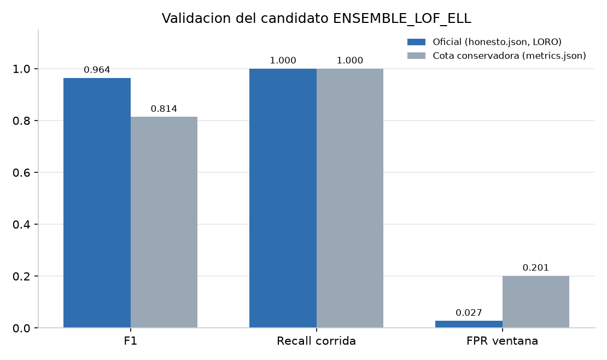

# Evidencia de indicadores — SteelNort

**Guía de definición:** [`docs/Indicadores_v2.md`](../Indicadores_v2.md)  
**Fase de evaluación (modelos, experimentos, carga):** [`docs/fase_evaluacion/`](../fase_evaluacion/README.md)

Esta carpeta no vuelve a *medir*: **muestra que cada indicador ya tiene artefacto, cifra y gráfico**. Fecha de consolidación: 2026-10-15.

Leyenda: **cumple** la meta del documento · **parcial** (criterio documentado o dependencia externa) · **pendiente** (hace falta un dato de Steel Nort).

## Tablero

| Cód. | Indicador | Meta | Valor medido | Estado | Ficha / gráfico |
|---|---|---|---|---|---|
| I-0 | Reducción del tiempo de detección | p < 0.05 (propuesto) | TTFA mediana 4.0 s; Wilcoxon p = 1.7×10⁻⁵ vs. supuesto 600 s | Parcial (O1 supuesto) | [ficha](fichas.md#i-0) · [I-0_ttfa.png](graficos/I-0_ttfa.png) |
| I-1.1 | Volumen extraído | Reportar | 21 corridas · 1050 filas · 3 330 métricas / 9 605 eventos / 2 946 logs / 425 sesiones | Cumple (reportado) | [ficha](fichas.md#i-11) |
| I-1.2 | Índice de calidad | ≥ 95 % | **99.72 %** (completitud 99.73 · consistencia 100 · validez 99.43) | **Cumple** | [calidad_indice.json](../../backend/app/tools/output/modelado/indicadores/calidad_indice.json) · [gráfico](graficos/I-1.2_calidad_datos.png) |
| I-2.1 | F1 de detección | ≥ 85 % | **0.9639** (`honesto.json`, LORO, q01) | **Cumple** | [ficha](fichas.md#i-21) · [ranking](graficos/I-2.1_ranking_esquemas.png) |
| I-2.2 | Correlación \|r\| ≥ 0.6 | identificar pares | **51 pares** Pearson | **Cumple** | [correlacion.json](../../backend/app/tools/output/modelado/correlacion.json) · [gráfico](graficos/I-2.2_correlacion.png) |
| I-3.1 | Precisión por tipo | ≥ 90 % | Top-2 **96.13 %** ventana / 91.7 % evento (Top-1 66.45 %) | **Cumple** (criterio Top-2) | [ficha](fichas.md#i-31) · [matriz](graficos/I-3.1_matriz_confusion.png) |
| I-3.2 | Coincidencia de severidad | ≥ 90 % | **95.83 %** (impacto P25/P75, tolerancia 1 nivel) | **Cumple** con criterio documentado | [severidad.json](../../backend/app/tools/output/modelado/indicadores/severidad.json) · [gráfico](graficos/I-3.2_severidad_deteccion.png) |
| I-3.3 | Efectividad del diagnóstico | ≥ 85 % | **91.67 %** (22/24, evento completo) | **Cumple** | [diagnostico_final.json](../../backend/app/tools/output/modelado/indicadores/diagnostico_final.json) · [gráfico](graficos/I-3.3_efectividad_diagnostico.png) |
| I-4.1 | Cumplimiento RF+RNF | 100 % (14/14) | **13/14** (RNF5 / encuesta I-4.3 abierta) | Parcial | [ficha](fichas.md#i-41) |
| I-4.2 | Tiempo dashboard y alertas | ≤ 3 s | Inferencia 0.22 ms; endpoints **181–224 ms** | **Cumple** | [latencia.json](../../backend/app/tools/output/modelado/validacion/latencia.json) · [gráfico](graficos/web_latencia_operaciones.png) |
| I-4.3 | Satisfacción de usuarios | ≥ 80 % | Encuesta no aplicada | Pendiente (externo) | [ficha](fichas.md#i-43) |
| I-5.1 | Recall | ≥ 85 % | **100 %** (13/13 corridas; 155/155 ventanas en test global; 0.9994 ± 0.0029 en 20 semillas) | **Cumple** | [honesto.json](../../backend/app/tools/output/modelado/indicadores/honesto.json) · [gráfico](graficos/I-5.1_recall_deteccion.png) |
| I-5.2 | Tiempo operaciones principales | ≤ 3 s | Mismo orden que I-4.2 (máx. documentado 224 ms; `/salud` 2088 ms) | **Cumple** | [ficha](fichas.md#i-52) · [gráfico](graficos/I-5.2_tiempos_operacion.png) |
| I-5.3 | Tasa de funcionamiento | ≥ 90 % | **18/18 = 100 %** | **Cumple** | [tasa_pruebas.json](../../backend/app/tools/output/modelado/indicadores/tasa_pruebas.json) · [gráfico](graficos/I-5.3_tasa_pruebas.png) |
| I-5.4 | Disponibilidad horario OLTP | ≥ 95 % | **30/30 = 100 %** (~6 min sobre `/api/v2/salud`) | **Cumple** (muestra corta) | [disponibilidad.json](../../backend/app/tools/output/modelado/indicadores/disponibilidad.json) · [gráfico](graficos/I-5.4_disponibilidad.png) |

**Cuentas para la tesis:** de los 15 ítems, **11 cumplen la meta con artefacto**, **3 son parciales/propuestos** (I-0, I-4.1, I-4.3) y **I-4.3** es el único que exige gente de Steel Nort.

Fichas con fórmula, comando de reproducción y captura del artefacto: [`fichas.md`](fichas.md).

