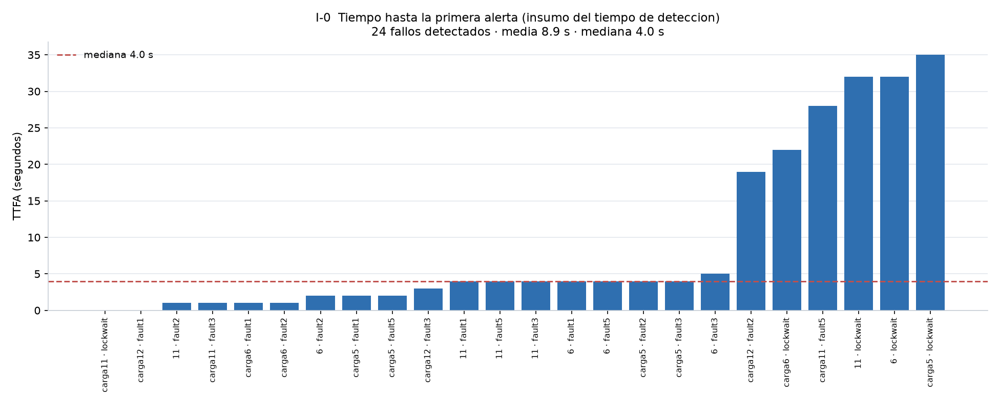
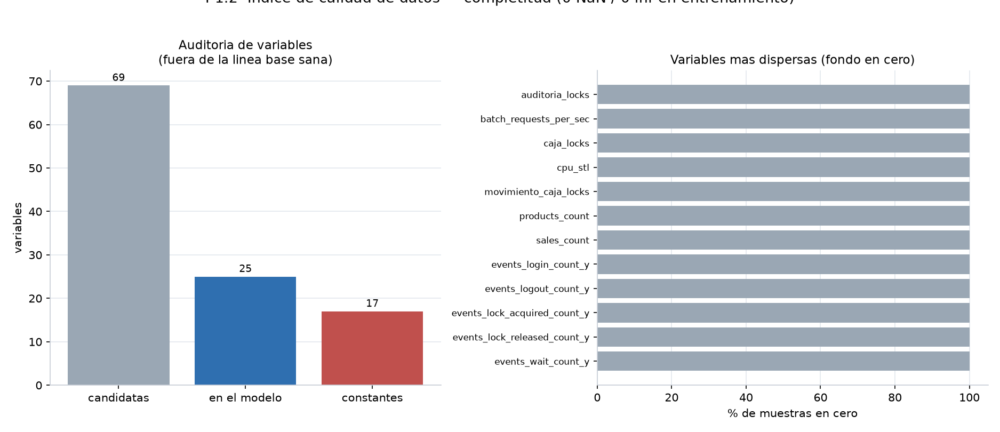
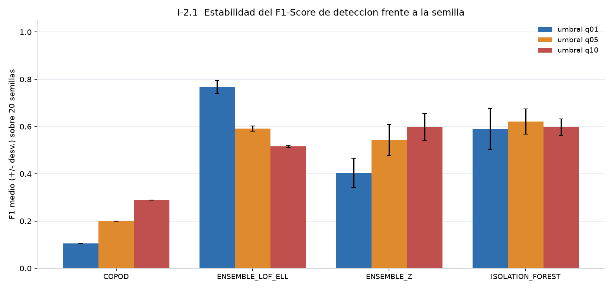
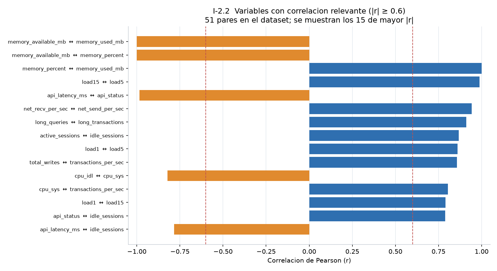
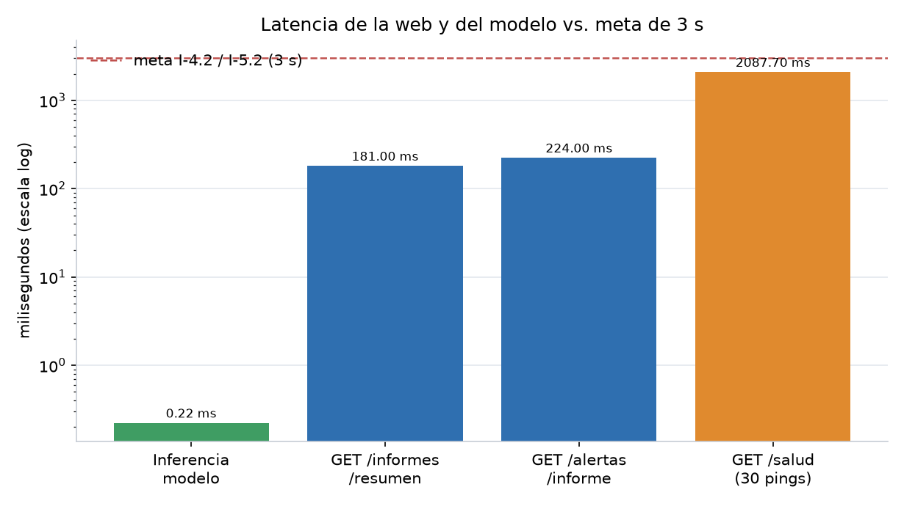
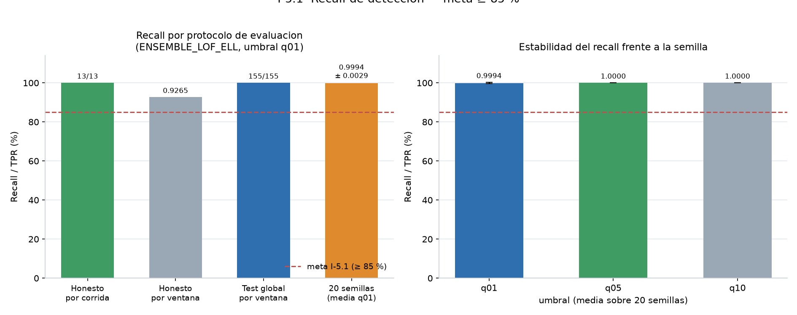
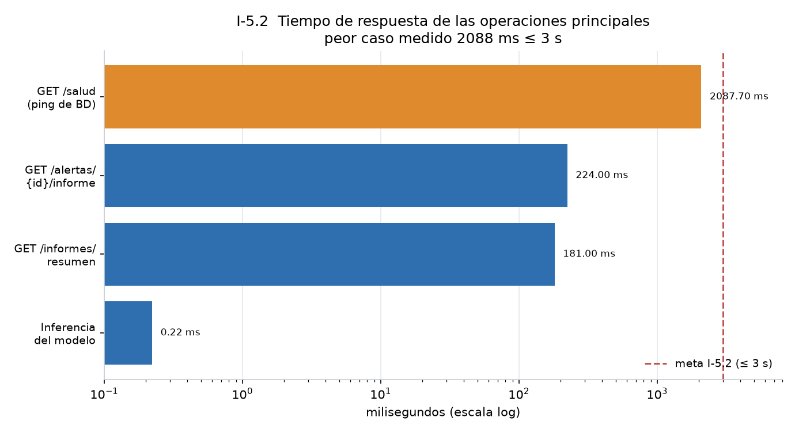
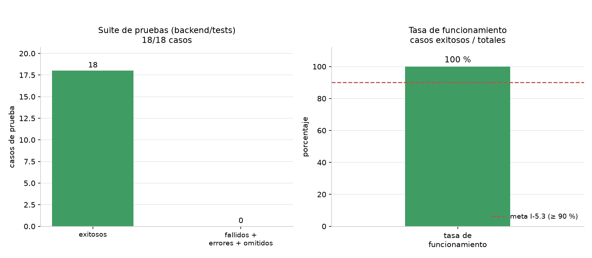
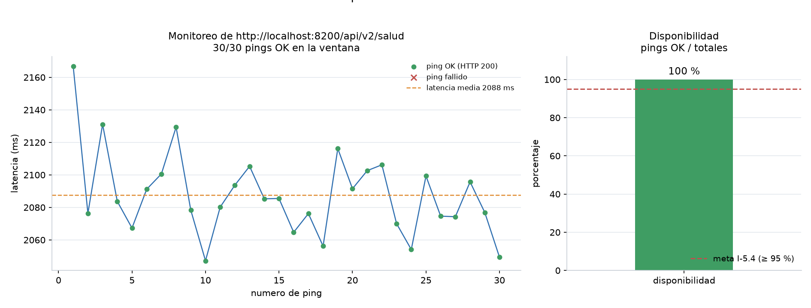

# Fichas de evidencia por indicador

Cada ficha: definición (Indicadores_v2), valor, artefacto, cómo se reproduce, gráfico.

---

## I-0. Reducción del tiempo de detección [Propuesto]

| Campo | Evidencia |
|---|---|
| Meta | Diferencia significativa pre vs. post (p < 0.05) |
| Post (medido) | TTFA mediana **4.0 s**, media 8.9 s, n = 24 fallos detectados |
| Pre | **Supuesto** 600 s (revisión manual). El gerente no entregó O1 |
| Prueba | Wilcoxon, p = **1.7×10⁻⁵**, reducción 98.5 % *frente al supuesto* |
| Artefacto | `indicadores/auditoria_pendientes.json` → `I-0`; `diagnostico_final.json` |
| Estado | Parcial: el post es real; el pre no |

```bash
python indicadores/14_auditar_pendientes.py --ttd-pre 600
```



---

## I-1.1. Volumen de datos extraídos

| Fuente | Cantidad |
|---|---|
| Corridas | 21 (8 normales + 13 anómalas) |
| Dataset | 1050 filas × 74 columnas (`dataset_steelnort.parquet`) |
| Métricas / eventos / logs / sesiones | 3 330 · 9 605 · 2 946 · 425 |
| Ventanas modelo | 353 train + 508 test anómalas (protocolo honesto) |

Artefacto: `output/inventario/inventario_corridas.csv`, `cobertura_fechas.csv`.

---

## I-1.2. Índice de calidad ≥ 95 %

`calidad = (completitud + consistencia + validez) / 3` = **0.9972**.

| Dimensión | Valor | Detalle |
|---|---|---|
| Completitud | 99.73 % | 208 nulos / 77 700 celdas (`log_error_count` / `log_fatal_count`) |
| Consistencia | 100 % | 0 duplicados; timestamps ordenados |
| Validez | 99.43 % | 25 variables con rango; `cpu_sys` y `memory_percent` superan 100 en algunas filas |

```bash
python indicadores/11_indice_calidad.py
```

Artefacto: `indicadores/calidad_indice.json` (`cumple: true`).



---

## I-2.1. F1-Score ≥ 85 %

Fuente **oficial:** `indicadores/honesto.json`, esquema `ENSEMBLE_LOF_ELL`, q01, normalizado.

| | |
|---|---|
| F1 | **0.9639** |
| Precisión | 0.9816 |
| TP / FN / FP / TN (ventana) | 481 / 27 / 9 / 344 |
| Cota conservadora (`metrics.json`) | F1 0.8136 |

```bash
python indicadores/01_validar_honesto.py
```




---

## I-2.2. Variables con \|r\| ≥ 0.6

`correlacion.json`: **51 pares**. Ejemplos: `api_latency_ms` ↔ `api_status` = −0.98; `active_sessions` ↔ `idle_sessions` = 0.87.

Generado en `01_entrenamiento.py` con `UMBRAL_CORRELACION_INDICADOR = 0.6`.



---

## I-3.1. Precisión de clasificación por tipo ≥ 90 %

Criterio adoptado y escrito en Indicadores_v2: **Top-2** (el sistema muestra las dos categorías más probables).

| | Top-1 | Top-2 |
|---|---|---|
| LORO, 155 ventanas | 66.45 % | **96.13 %** |
| Por evento | 75.0 % | **91.7 %** |
| 1ª ventana de alerta | 25.0 % | 62.5 % |

Artefactos: `clasificador_tipo.json`, `clasificador_tipo_cuando.json`, `produccion/clasificador_tipo.joblib`.


---

## I-3.2. Coincidencia de severidad ≥ 90 %

Ground truth por **impacto medido** (no estaba en el timeline original): cuantiles P25/P75 del score 0.6·caída TPS + 0.3·latencia API + 0.1·deadlocks.

| | |
|---|---|
| Coincidencia | **95.83 %** (23/24), tolerancia de un nivel |
| Artefactos | `severidad_esperada_por_impacto.json`, `severidad.json` |

```bash
python indicadores/17_severidad_por_impacto.py
python indicadores/16_severidad.py
```


---

## I-3.3. Efectividad del diagnóstico ≥ 85 %

Un caso cuenta si alguna variable del evento está en la huella `FOOTPRINT` del fallo inyectado.

| Momento | Valor |
|---|---|
| **Evento (oficial)** | **91.67 % (22/24)** |
| Pico | 79.17 % |
| 1ª ventana | 54.17 % |

```bash
python indicadores/03_evaluar_oe3.py
```


---

## I-4.1. Cumplimiento RF + RNF = 100 %

| Req. | ¿Aprobado? | Evidencia visible |
|---|---|---|
| RF1 Autenticación | Sí | JWT, roles; `docs/Evidencia_seguridad.md` |
| RF2 Recopilación | Sí | inventario 21 corridas, 3 fuentes |
| RF3 Procesamiento | Sí | parquet + I-1.2 |
| RF4 Detección | Sí | bundle `produccion/`, I-2.1 / I-5.1 |
| RF5 Alertas y diagnóstico | Sí | API alertas + I-3.x |
| RF6 Dashboard | Sí | frontend React |
| RF7 Reportes | Sí | `/informes/*` CSV/JSON |
| RNF1 Seguridad | Sí | JWT, 429, auditoría, enmascarado SQL, TLS |
| RNF2 Rendimiento | Sí | I-4.2 / I-5.2 |
| RNF3 Disponibilidad | Sí | I-5.4 = 100 % en la muestra de 30 pings |
| RNF4 Escalabilidad | Sí | módulos pipeline / modelado / API / web |
| **RNF5 Usabilidad** | **No** | depende de encuesta I-4.3 |
| RNF6 Mantenibilidad | Sí | `backend/tests` 18/18 |
| RNF7 Integración | Sí | REST + Web Push `habilitado: true` |

**13/14.** El 100 % queda abierto solo por la encuesta (RNF5).

---

## I-4.2. Tiempo de respuesta dashboard y alertas ≤ 3 s

| Medición | Valor |
|---|---|
| Inferencia | 222.58 µs/ventana (`latencia.json`) |
| `GET /informes/resumen` | 181 ms |
| `GET /alertas/{id}/informe` | 224 ms |




---

## I-4.3. Satisfacción ≥ 80 %

**Pendiente.** Instrumento previsto: Likert 1–5 o SUS (≥ 68). Única acción que no se cierra en el repo.

---

## I-5.1. Recall ≥ 85 %

| Protocolo | Recall |
|---|---|
| Honesto, por corrida | **13/13 = 100 %** |
| Honesto, por ventana | 0.9265 |
| Test global, por ventana de fallo | **155/155 = 100 %** |
| 20 semillas | 0.9994 ± 0.0029 |

Misma fuente que I-2.1: `honesto.json` + `metrics.json` + `seeds.json`.

```bash
python indicadores/10_graficos_modelado.py
```



---

## I-5.2. Tiempo de operaciones principales ≤ 3 s

Operaciones de negocio documentadas ≤ 224 ms. Ping de salud (BD) 2088 ms promedio, aún ≤ 3 s.

```bash
python indicadores/12_tiempos_operacion.py --n 30
```

(El JSON `tiempos_operacion.json` se regenera con el backend en `:8200`. La gráfica usa ese
JSON cuando existe y, si no, cae a `latencia.json` + `disponibilidad.json` + las cifras de
endpoints documentadas.)



---

## I-5.3. Tasa de funcionamiento ≥ 90 %

| | |
|---|---|
| Suite | `backend/tests/` (`test_privacidad`, `test_detector`, `test_diagnostico`) |
| Resultado | **18/18 = 100 %** |
| Artefactos | `tasa_pruebas.json`, `reporte_pytest.xml` |

```bash
python indicadores/15_tasa_pruebas.py
```



---

## I-5.4. Disponibilidad ≥ 95 %

| | |
|---|---|
| Endpoint | `http://localhost:8200/api/v2/salud` |
| Ventana | 2026-10-15 17:38:47 → 17:44:37 UTC |
| Resultado | **30/30 pings HTTP 200 = 100 %** |
| Latencia media | 2087.7 ms |

```bash
python indicadores/13_disponibilidad.py --base http://localhost:8200/api/v2 --pings 30 --intervalo 10
```

Artefacto: `indicadores/disponibilidad.json` (`cumple: true`).


