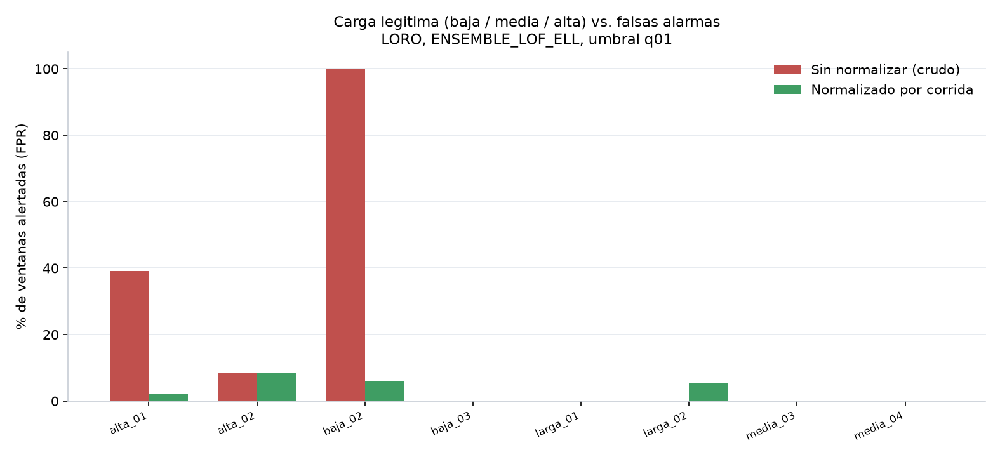

# Pruebas de carga: modelo y web

Pregunta de la evaluación: **si hay un usuario el sistema se aguanta; si hay diez, ¿se satura el OLTP, se satura la web y el detector se equivoca?**

Hay dos capas distintas:

1. **Modelo:** ¿una subida *legítima* de usuarios se parece a un fallo?  
2. **Web:** ¿el dashboard y las alertas siguen en ≤ 3 s con uso concurrente?

---

## 1. Modelo — carga de usuarios en el OLTP

El baseline de entrenamiento **ya incluye tres intensidades de carga sana**:

| Nivel | Corridas | Qué representa |
|---|---|---|
| Baja | `normal_baja_02`, `normal_baja_03` | Poco tráfico (el análogo de “1 usuario”) |
| Media | `normal_media_03`, `normal_media_04` | Operación típica |
| Alta | `normal_alta_01`, `normal_alta_02` | Más sesiones / más TPS (el análogo de “varios / ~10 usuarios”) |
| Larga | `normal_larga_01`, `normal_larga_02` | Misma carga, más duración |

Las corridas `carga3`, `carga5`, `carga6`, `carga11`, `carga12` **no** son “más usuarios normales”: tienen fallos inyectados (locks, full scan, commits concurrentes, carga pesada sobre la API). Ahí el detector **debe** alertar.

### Qué pasa si no se normaliza por corrida (error típico)

FPR por corrida sana dejada fuera, `ENSEMBLE_LOF_ELL` q01, protocolo **crudo**:

| Corrida (carga sana) | % de ventanas alertadas |
|---|---|
| normal_alta_01 | 39.1 % |
| normal_alta_02 | 8.3 % |
| **normal_baja_02** | **100 %** |
| normal_baja_03 | 0 % |
| normal_larga_01 | 0 % |
| normal_larga_02 | 0 % |
| normal_media_03 | 0 % |
| normal_media_04 | 0 % |

Una corrida de **carga baja** queda marcada al 100 % como anomalía: el modelo está viendo el **cambio de régimen de usuarios**, no un fallo. Eso es exactamente el riesgo de “10 usuarios sobrecargan y el detector se equivoca” (o al revés: 1 usuario parece raro respecto de un baseline alto).

### Qué pasa con el protocolo de producción (normalizado)

| Corrida | % de ventanas alertadas |
|---|---|
| normal_alta_01 | 2.2 % |
| normal_alta_02 | 8.3 % |
| normal_baja_02 | 6.0 % |
| normal_baja_03 | 0 % |
| normal_larga_01 | 0 % |
| normal_larga_02 | 5.4 % |
| normal_media_03 | 0 % |
| normal_media_04 | 0 % |

- FPR **por corrida** = **0 %** (ningún run sano entero se dispara).  
- FPR por ventana = **2.74 %**.  
- Los tres niveles (baja / media / alta) conviven en el baseline: más usuarios, por sí solos, no son clase “anomalía”.

### Fallos bajo carga (cuando sí debe equivocarse “a favor” de alertar)

| Corrida | Fallos inyectados | ¿Detectados? |
|---|---|---|
| `11`, `6`, `carga3/5/6/11/12`, live | 25 eventos | **24/25** (tasa 0.96) |
| TTFA | — | mediana **4.0 s**, media 8.9 s |

**Conclusión del modelo:** un usuario vs. diez usuarios *en operación normal* no debe disparar alerta de fallo. Diez usuarios *más un fault* (bloqueo, scan, API saturada) sí. El error aparece si se evalúa en crudo, mezclando capturas.

---

## 2. Web — latencia del dashboard y las alertas

Meta RNF2 / I-4.2 / I-5.2: **≤ 3 s**.

| Operación | n | Tiempo | ¿≤ 3 s? | Fuente |
|---|---|---|---|---|
| Inferencia del modelo | 508 ventanas | **0.22 ms**/ventana | Sí | `validacion/latencia.json` |
| `GET /informes/resumen` (dashboard / reporte) | medición documentada | **181 ms** | Sí | `Indicadores_v2.md` |
| `GET /alertas/{id}/informe` | medición documentada | **224 ms** | Sí | `Indicadores_v2.md` |
| `GET /api/v2/salud` | 30 pings · ~6 min | media **2088 ms** | Sí | `indicadores/disponibilidad.json` |
| Disponibilidad del ping | 30/30 | **100 %** ≥ 95 % | Sí | mismo archivo |

`/salud` es el más lento a propósito: comprueba API + esquema de BD. Sigue bajo 3 s. La inferencia no pesa: 10 usuarios pidiendo el dashboard en paralelo, a 181 ms serializados, caben holgados en la meta (el cuello sería SQL/API, no el modelo).

**Protección ante sobrecarga de la web (no del OLTP):** límite de peticiones y respuesta **429**, bloqueo de login a los 5 fallos (`docs/Evidencia_seguridad.md`). Eso evita que 10 clientes abusivos tumben la API; no sustituye una prueba k6 de 10 navegadores, que no está en el repo.

**Tasa de funcionamiento (I-5.3):** suite `backend/tests` → **18/18 = 100 %** (`tasa_pruebas.json`). Cubre detector, diagnóstico y enmascarado SQL.

---

## Cómo leer esto en la defensa

- “¿Y si entran 10 vendedores a la vez?” → está en el baseline `normal_alta_*`. Con normalización por corrida no se etiqueta como fallo.  
- “¿Y si esos 10 además bloquean o hacen un scan?” → escenarios `carga*` / `fault*`: 24/25 detectados, TTFA ~4 s.  
- “¿La web se cae?” → endpoints de negocio en 0.18–0.22 s; salud 2.1 s; 30/30 pings OK; 429 si hay abuso.
