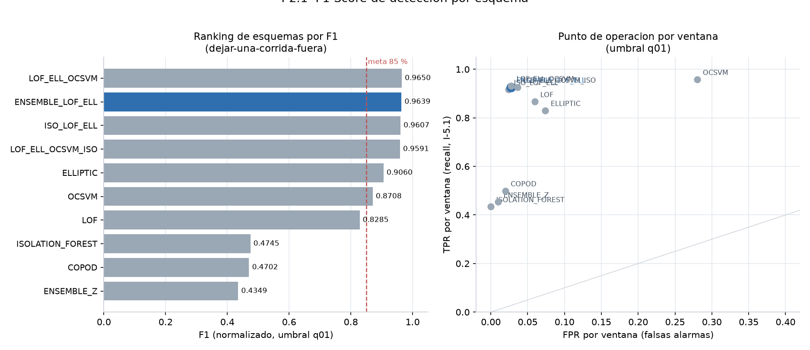
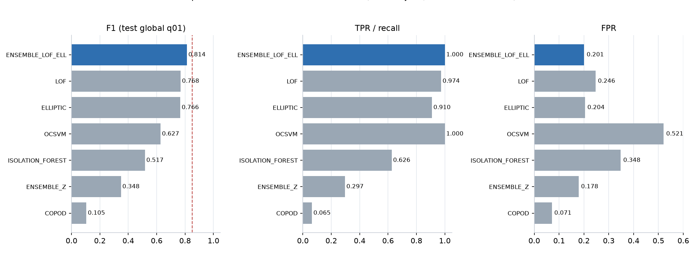
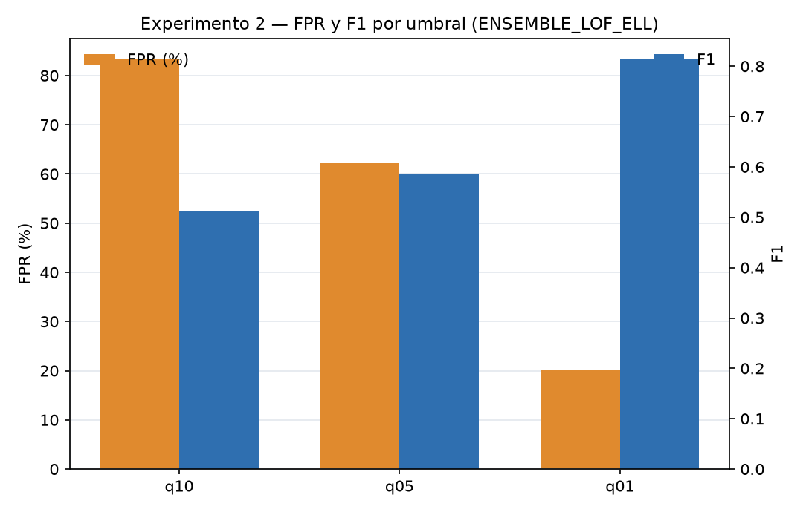
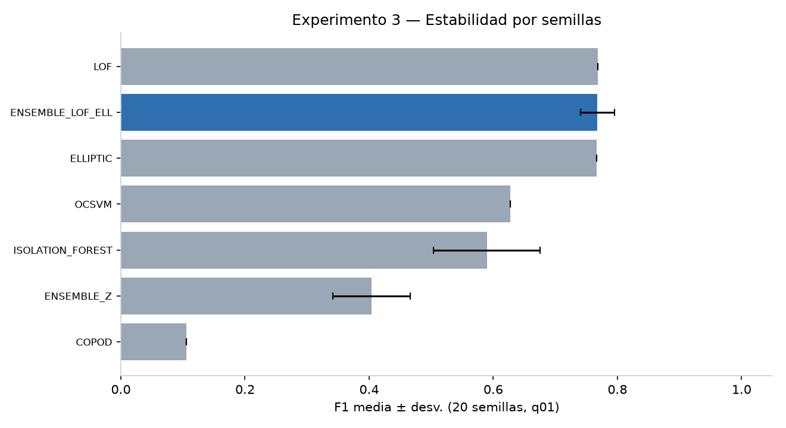

# Comparación de modelos y experimentos

**Fuentes:**  
`backend/app/tools/output/modelado/experimentos/` (`INFORME_COMPLETO_EXPERIMENTOS_TESIS.md` y CSV),  
`indicadores/honesto.json`, `validacion/metrics.json`, `validacion/seeds.json`.

## Configuración común

| Parámetro | Valor |
|---|---|
| Entrenamiento (baseline sano) | 353 ventanas · 8 corridas `normal_*` |
| Test (protocolo global / legacy) | 508 ventanas = 155 de fallo + 353 normales |
| Test (protocolo honesto) | 508 ventanas anómalas + LORO sobre las 8 normales |
| Ventana | 10 s |
| Features | 25 (ver `produccion/meta.json`) |
| Esquemas | Isolation Forest, COPOD, LOF, OCSVM, Elliptic Envelope, `ENSEMBLE_Z`, `ENSEMBLE_LOF_ELL` |

El RF4 del proyecto hablaba de Isolation Forest. Se **comparó** y **no se eligió**: en el ranking honesto Isolation Forest queda en F1 0.4745 y `ENSEMBLE_Z` (ISO+COPOD) último (0.4349). El desplegado es LOF + Elliptic.

---

## Ranking honesto (fuente oficial del indicador I-2.1)

Protocolo: dejar-una-corrida-fuera + normalización por corrida, umbral q01.

| # | Esquema | F1 | TPR corrida | FPR corrida |
|---|---|---|---|---|
| 1 | LOF_ELL_OCSVM | 0.9650 | 1.00 | 0.00 |
| **2** | **ENSEMBLE_LOF_ELL (desplegado)** | **0.9639** | **1.00** | **0.00** |
| 3 | ISO_LOF_ELL | 0.9607 | 1.00 | 0.00 |
| 4 | LOF_ELL_OCSVM_ISO | 0.9591 | 1.00 | 0.00 |
| 5 | ELLIPTIC | 0.9060 | 0.92 | 0.00 |
| 6 | OCSVM | 0.8708 | 1.00 | 0.125 |
| 7 | LOF | 0.8285 | 1.00 | 0.00 |
| 8 | Isolation Forest | 0.4745 | 0.38 | 0.00 |
| 9 | COPOD | 0.4702 | 0.46 | 0.00 |
| 10 | ENSEMBLE_Z | 0.4349 | 0.38 | 0.00 |

Se eligió el **segundo** y no el primero porque el triple LOF+ELL+OCSVM gana 0.0011 de F1 pero arrastra el FPR de OCSVM en otros protocolos (52 % en test global). LOF+ELL queda a 0.0011 y es más simple.

Punto de operación del desplegado (`honesto.json`, q01, normalizado):

| Métrica | Valor |
|---|---|
| F1 | **0.9639** |
| Precisión | 0.9816 |
| TPR ventana | 0.9265 |
| TPR corrida (I-5.1) | **1.000** (13/13) |
| FPR ventana | 0.0274 |
| FPR corrida | **0.000** |
| n | 481 TP · 27 FN · 9 FP · 344 TN |



---

## Experimento 1 — Rendimiento ante fallos (test global, q01)

508 ventanas: 155 de fallo + 353 normales. Cota **conservadora** (no es el valor de I-2.1).

| Esquema | TP | FN | FP | TN | TPR | FPR | Precisión | F1 |
|---|---|---|---|---|---|---|---|---|
| **ENSEMBLE_LOF_ELL** | **155** | **0** | 71 | 282 | **100 %** | 20.11 % | 0.6858 | **0.8136** |
| LOF | 151 | 4 | 87 | 266 | 97.42 % | 24.65 % | 0.6345 | 0.7684 |
| ELLIPTIC | 141 | 14 | 72 | 281 | 90.97 % | 20.40 % | 0.6620 | 0.7663 |
| OCSVM | 155 | 0 | 184 | 169 | 100 % | 52.12 % | 0.4572 | 0.6275 |
| Isolation Forest | 97 | 58 | 123 | 230 | 62.58 % | 34.84 % | 0.4409 | 0.5173 |
| ENSEMBLE_Z | 46 | 109 | 63 | 290 | 29.68 % | 17.85 % | 0.4220 | 0.3485 |
| COPOD | 10 | 145 | 25 | 328 | 6.45 % | 7.08 % | 0.2857 | 0.1053 |

CSV: `experimentos/experimento1_rendimiento_fallos.csv`.



---

## Experimento 2 — Tasa de falsos positivos por umbral

Sobre el mismo test global. Umbrales percentílicos del baseline.

| Umbral | TP | FN | FP | TN | FPR | Precisión | F1 |
|---|---|---|---|---|---|---|---|
| q10 | 155 | 0 | 294 | 59 | 83.29 % | 0.3452 | 0.5132 |
| q05 | 155 | 0 | 220 | 133 | 62.32 % | 0.4133 | 0.5849 |
| **q01 (producción)** | **155** | **0** | **71** | **282** | **20.11 %** | **0.6858** | **0.8136** |

Conclusión: umbrales holgados (q10/q05) detectan todo, pero saturan de falsas alarmas. **q01** es el punto que equilibra recall 100 % con el menor FPR de los tres.



---

## Experimento 3 — Estabilidad por semillas (n = 20)

| Modelo | Determinista | TPR | FPR | F1 |
|---|---|---|---|---|
| **ENSEMBLE_LOF_ELL** | No | **0.9994 ± 0.0029** | 26.66 % ± 4.26 % | 0.7678 ± 0.0275 |
| LOF | Sí | 0.9742 ± 0 | 24.65 % ± 0 | 0.7684 ± 0 |
| ELLIPTIC | Sí (`random_state=42`) | 0.9097 ± 0 | 20.40 % ± 0 | 0.7663 ± 0 |
| Isolation Forest | No | 0.7081 ± 0.1311 | 29.93 % ± 3.55 % | 0.5896 ± 0.0859 |
| ENSEMBLE_Z | No | 0.3681 ± 0.0689 | 19.56 % ± 2.05 % | 0.4040 ± 0.0625 |
| COPOD | Sí | 0.0645 ± 0 | 7.08 % ± 0 | 0.1053 ± 0 |
| OCSVM | Sí | 1.000 ± 0 | 52.12 % ± 0 | 0.6275 ± 0 |

El ensamble elegido es **estable en recall** (desv. 0.0029). Isolation Forest no lo es (desv. 0.13 en TPR).




---

## Cómo reproducir

```text
python experimental/03_validar_candidato.py --stage metrics
python experimental/03_validar_candidato.py --stage seeds
python indicadores/01_validar_honesto.py
python indicadores/10_graficos_modelado.py
python docs/fase_evaluacion/_generar_graficos_eval.py
```
