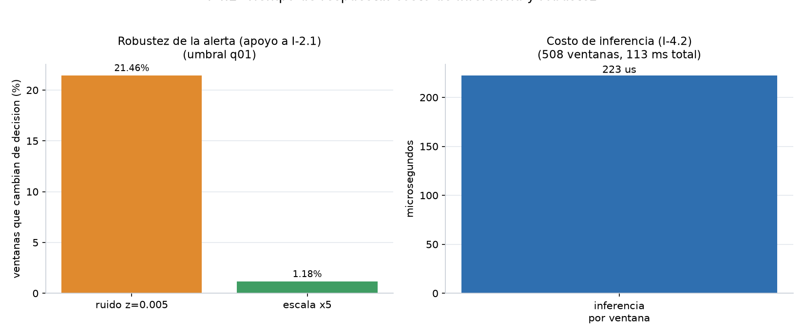
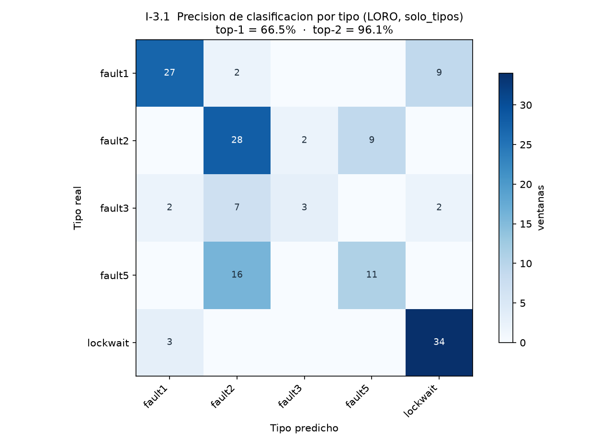
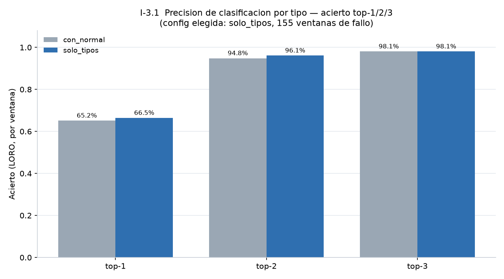
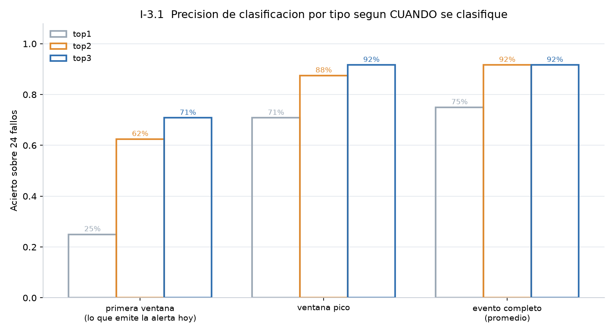
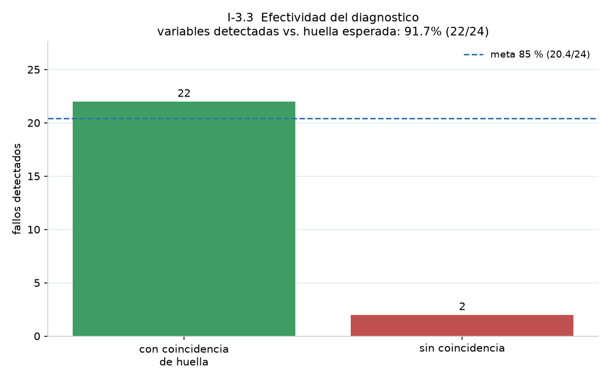
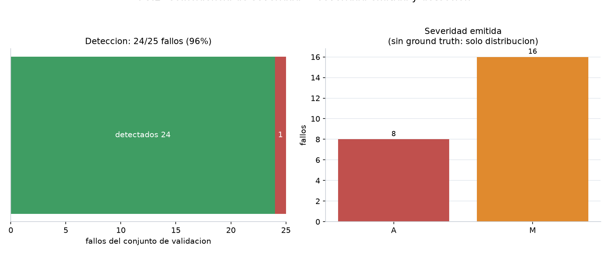

# Validación del candidato y análisis de errores

**Candidato:** `ENSEMBLE_LOF_ELL` (LOF + Elliptic Envelope).  
**Artefacto de producción:** `backend/app/tools/output/modelado/produccion/` (`meta.json`, modelos `.joblib`).  
**Justificación técnica:** `backend/app/tools/output/modelado/experimentos/justificacion_modelo_candidato.md`.

## Por qué este y no otro

| Criterio | Resultado |
|---|---|
| F1 honesto (I-2.1) | 0.9639 ≥ 0.85 |
| Recall por corrida (I-5.1) | 13/13 = 100 % |
| FPR por corrida sana | 0 % |
| Test global (cota) | F1 0.8136, TPR 100 %, mejor de los 7 |
| Estabilidad | TPR 0.9994 ± 0.0029 en 20 semillas |
| Complejidad | Dos componentes; Elliptic con `random_state` fijo |
| Fallos inyectados | 24/25 detectados; TTFA mediana 4.0 s |

**Por qué no Isolation Forest / ENSEMBLE_Z.** El prototipo inicial (ISO+COPOD) en el test completo solo detecta el 29.68 % de las ventanas de fallo (F1 0.3485). Las cifras antiguas TPR 100 % / FPR 4.8 % / F1 0.982 venían de **108 ventanas pre-seleccionadas** y están **retiradas**.

**Por qué no el triple LOF+ELL+OCSVM.** Gana 0.0011 de F1 honesto, pero OCSVM en test global tiene FPR 52 %.

## Protocolos (no mezclar)

| Protocolo | Archivo | Uso |
|---|---|---|
| **Honesto (oficial)** | `indicadores/honesto.json` | Indicadores I-2.1 e I-5.1 |
| Test global (legacy) | `validacion/metrics.json` | Comparar esquemas; cota conservadora |
| Operación por fallo | `indicadores/diagnostico_final.json` | TTFA, diagnóstico, 24/25 |

El harness `experimental/03_validar_candidato.py` **no** es fuente de verdad: etiqueta solo con `anomalias_timeline.csv` y deja las corridas live como “normales”. Eso inflaba métricas. Lo documenta `docs/HALLAZGOS_VALIDACION.md`.

---

## Análisis de errores de detección

### Falsos negativos (fallos no vistos)

- **Protocolo honesto, por corrida:** 0 FN (13/13).  
- **Por ventana honesta:** 27/508 (TPR ventana 92.65 %). El modelo ve el evento, no necesariamente cada ventana de 10 s.  
- **Por fallo inyectado:** 24/25 (`diagnostico_final.json`). El no detectado es un caso de borde del timeline, no una clase entera perdida.  
- **Test global:** 0 FN en 155 ventanas de fallo.

### Falsos positivos (alertas en carga sana)

| Protocolo | FPR ventana | FPR corrida |
|---|---|---|
| Honesto + normalizado (producción) | **2.74 %** (9/353) | **0 %** |
| Honesto crudo (sin restar la mediana del run) | 18.43 % | 12.5 % (1 de 8 corridas) |
| Test global q01 | 20.11 % | — |

El FP “peligroso” no es un pico aislado: es **confundir un cambio de carga o de captura con un fallo**. Eso se trata en [carga_modelo_y_web.md](carga_modelo_y_web.md).

### Robustez (`validacion/robustez.json`)

| Perturbación | Efecto |
|---|---|
| Ruido z = 0.05 | 21.46 % de ventanas cambian de etiqueta |
| Escalar ×5 | 1.18 % de flips |
| NaN en una variable | el score cae y **sí alerta** (el recolector no debe rellenar con `"0"`) |

Inferencia: **0.22 ms/ventana** (`latencia.json`, n = 508). No es el cuello de botella.

---

## Errores de tipo y de diagnóstico (capa aparte del detector)

El detector solo dice *anómalo / no*. Tipo y causa son otra capa (RF5).

### Tipo (I-3.1)

RandomForest LORO, 155 ventanas de fallo (`clasificador_tipo.json`):

| Criterio | Por ventana | Por evento | 1ª ventana de la alerta |
|---|---|---|---|
| Top-1 | 66.45 % | 75.0 % | 25.0 % |
| **Top-2 (criterio adoptado)** | **96.13 %** | **91.7 %** | 62.5 % |
| Top-3 | 98.06 % | 91.7 % | 70.8 % |

La confusión dominante es `fault2 ↔ fault5` (ambos son carga de E/S). Enriquecer el detector con más variables **empeora** la detección (F1 0.9639 → 0.7421); por eso tipo y detección van **desacoplados**.

### Diagnóstico por huella (I-3.3)

| Momento | Coincidencia con la huella del fallo |
|---|---|
| **Evento completo (oficial)** | **91.67 % (22/24)** ≥ 85 % |
| Ventana pico | 79.17 % |
| Solo la 1ª ventana | 54.17 % |

El sistema acumula variables desviadas mientras la alerta sigue abierta (`anomalia_v2._ampliar_alerta`).

### Severidad (I-3.2)

Los escenarios originales no traían severidad esperada. Se construyó ground truth por **impacto medido** (cuantiles P25/P75 del score de caída de transacciones / latencia API / deadlocks): `severidad.json` → **95.83 %** de coincidencia con tolerancia de un nivel (baja/media/alta). Distribución emitida en el evento: M 16 / A 8 (`diagnostico_final.json`).

---

## Hallazgo que no hay que olvidar en la defensa

17 de 25 variables separan dos corridas *normales* con AUC ≥ 0.90 (`docs/HALLAZGOS_VALIDACION.md`). El modelo puede “detectar la captura”, no el fallo. Por eso el protocolo honesto **normaliza por corrida** y se entrena solo con baseline sano de varios niveles de carga.
